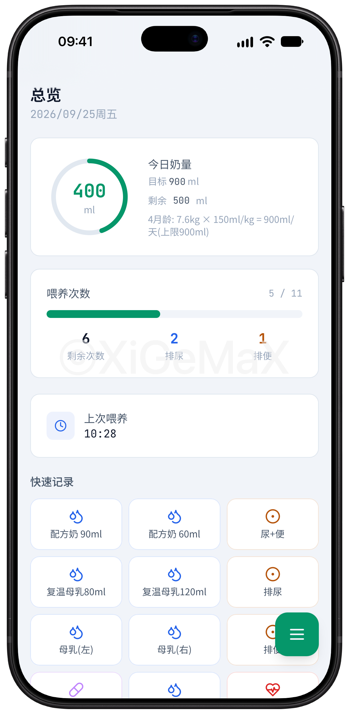
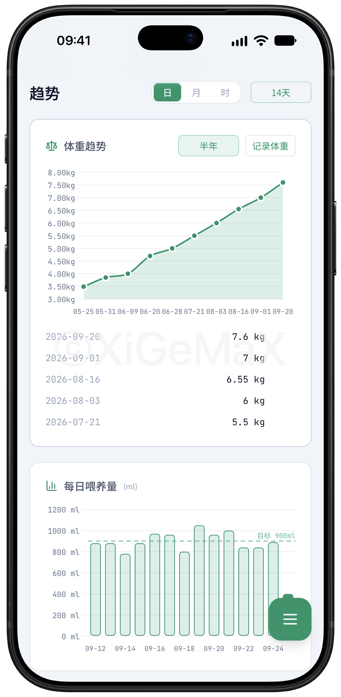
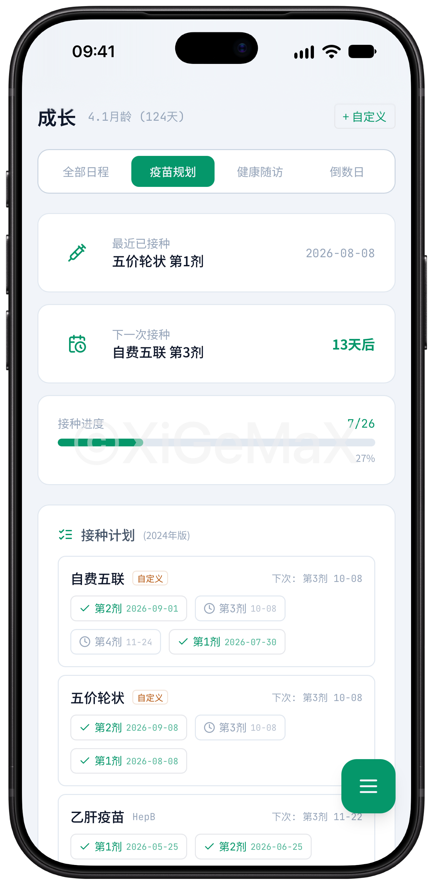
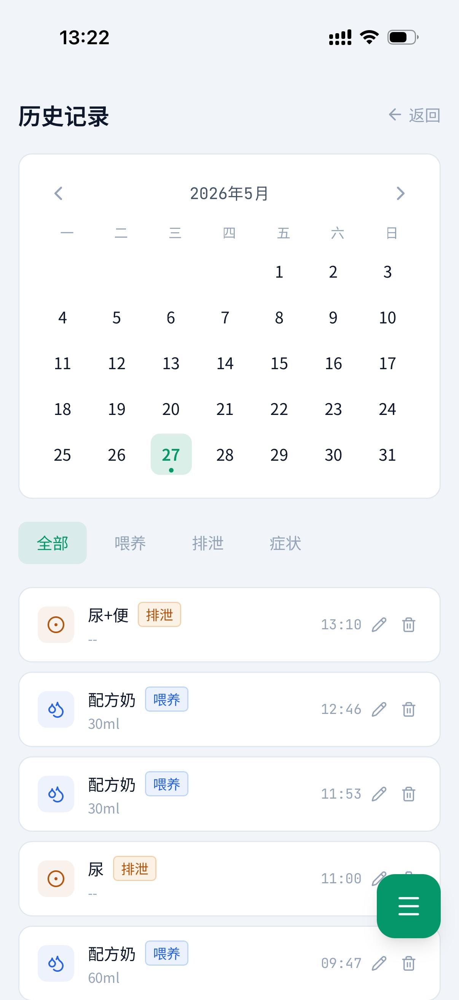

<div align="center">

# Baby Tracker

**新生儿与婴幼儿喂养、排泄和成长数据记录系统**

自托管部署，数据保存在本机 SQLite 数据库中，支持手机浏览器、PWA、Home Assistant 和 MCP。

[](https://go.dev/)
[](https://github.com/XiGeMaX/Baby_tracker/pkgs/container/baby_tracker)
[](LICENSE)

</div>

## 项目简介

Baby Tracker 面向家庭自托管场景，覆盖喂养、排泄、体重、疫苗、健康随访和倒数日等记录。服务端使用 Go 原生二进制，数据存储使用 SQLite，前端为服务端模板和原生 JavaScript，所有前端依赖均随仓库提供，不依赖公网 CDN。

首次启动会创建默认管理员：

- 用户名：`admin`
- 初始密码：`admin123`

首次登录后必须设置新的管理密码。正式部署前还应设置随机的 `SECRET_KEY`。

## 功能

- 总览：今日奶量目标、喂养次数、尿便次数、上次喂养和快捷记录。
- 趋势：体重、每日喂养量、辅食、排尿排便和时段分布。
- 成长：2026 版疫苗规划、健康随访、自定义日程和倒数日。
- 家庭共享：用户注册、管理员审批、角色管理和密码管理。
- 数据管理：CSV 导出、JSON 备份恢复、操作日志和统计。
- Home Assistant：传感器、快速记录开关和独立 API Key。
- MCP：默认关闭，由管理员启用，使用独立 API Key 鉴权。
- PWA：可安装到手机主屏幕，支持亮色、暗色和减少动态效果偏好。

## 界面预览

| 总览 | 趋势 |
| --- | --- |
|  |  |

| 成长 | 历史 |
| --- | --- |
|  |  |

## Docker 部署

仓库未内置 `docker-compose.yml`，请在部署目录中创建：

```yaml
services:
  baby-tracker:
    container_name: baby_tracker
    image: ghcr.io/xigemax/baby_tracker:latest
    ports:
      - "8964:5000"
    volumes:
      - ./data:/var/lib/baby-tracker
    environment:
      TZ: Asia/Shanghai
      SECRET_KEY: "please-change-this-secret-key"
    restart: unless-stopped
```

启动：

```bash
docker compose up -d
```

浏览器访问 `http://<服务器地址>:8964`。若直接使用源码构建镜像：

```bash
docker build -t baby-tracker .
docker run -d --name baby-tracker -p 8964:5000 \
  -e SECRET_KEY="please-change-this-secret-key" \
  -v "$PWD/data:/var/lib/baby-tracker" \
  baby-tracker
```

从旧版镜像升级且仍使用 `./data:/app/data` 挂载时无需修改 compose。镜像会优先识别旧目录中的 `baby.db`，修正挂载目录权限后再以非 root 用户启动。如果同时发现两个都已有业务数据的数据库，服务会停止并提示使用 `BABY_TRACKER_DATA_DIR` 明确选择，避免覆盖或误建管理员。

## Go 本地运行

要求 Go 1.26.11 或兼容的新版本。

```bash
make setup
make start
```

默认访问 `http://127.0.0.1:8964`。`make start` 会下载并校验 Go 模块，构建到 `.build/baby-tracker`，然后在后台启动服务。首次运行会自动创建 `data/baby.db`、默认管理员和会话密钥，因此本机测试不需要预先设置 `SECRET_KEY`。

常用管理命令：

```bash
make status
make logs
make stop
```

需要在前台查看完整输出时使用 `make run`。修改监听地址时使用 `make start LISTEN_ADDRESS=127.0.0.1:5001`，修改数据目录时使用 `make start DATA_DIR=/path/to/data`。

构建二进制：

```bash
make build
.build/baby-tracker serve
```

## 配置

| 变量 | 默认值 | 说明 |
| --- | --- | --- |
| `SECRET_KEY` | 自动生成并保存到数据目录 | 会话签名密钥，生产环境建议显式设置随机值 |
| `BABY_TRACKER_DATA_DIR` | `./data` | SQLite 和运行时数据目录 |
| `BABY_TRACKER_LEGACY_DATA_DIR` | 镜像内为 `/app/data` | 旧版 Docker 数据目录；仅在新目录没有可恢复数据时作为兼容路径 |
| `BABY_TRACKER_WEB_DIR` | `.` | 包含 `templates/` 和 `static/` 的目录 |
| `BABY_TRACKER_LISTEN_ADDRESS` | `0.0.0.0:5000` | HTTP 监听地址 |
| `PORT` | 未设置 | `BABY_TRACKER_LISTEN_ADDRESS` 未设置时可用于平台部署 |
| `BABY_TRACKER_BASE_PATH` | 空 | 反向代理子路径，例如 `/baby-tracker` |
| `TZ` | 系统时区 | 记录时间和日期统计使用的时区 |

如果未提供 `SECRET_KEY`，服务会在数据目录写入权限为 `0600` 的 `secret_key` 文件，保证重启后会话仍然有效。

## 数据与备份

- 数据库文件：`data/baby.db`
- SQLite 运行时还可能生成 `baby.db-wal` 和 `baby.db-shm`
- 推荐使用管理页的 JSON 备份和恢复功能
- 直接复制数据库前应先停止服务，并一并复制 WAL 文件
- 备份文件包含用户密码哈希和业务数据，应妥善保管

管理页恢复备份时会先校验数据表、列名和行数据。任何插入错误都会回滚整次恢复，不会返回部分恢复成功。

## API

完整 REST、Home Assistant 和 MCP 传输端点契约见 [API 规范](docs/API.md)。除登录态探测 `GET /api/auth/me` 外，所有业务读取接口都要求鉴权。

## Home Assistant

管理界面可生成传感器、开关和 API Key 配置。完整说明见 [Home Assistant 集成指南](docs/ha-integration.md)。

```yaml
sensor:
  - platform: rest
    name: "宝宝今日奶量"
    resource: "http://<IP>:8964/api/ha/status"
    value_template: "{{ value_json.state }}"
    unit_of_measurement: "ml"
    json_attributes_path: "$.attributes"
    json_attributes:
      - total_feed_ml
      - target_ml
      - feed_count
      - last_feed_time
    headers:
      Authorization: "Bearer <API_KEY>"
```

HA 传感器读取和快速记录接口都需要鉴权，支持 `Authorization: Bearer <API_KEY>`、`X-API-Key: <API_KEY>`，并保留 `?api_key=` 兼容参数。完整接口契约见 [API 规范](docs/API.md)。

## MCP

MCP 默认关闭。管理员在“管理 > 管理配置”中启用并生成独立 API Key 后，端点位于：

```text
http://<服务器地址>:<端口>/mcp
```

请求使用 Streamable HTTP，并通过 Bearer 密钥鉴权：

```http
Authorization: Bearer <MCP_API_KEY>
```

管理页提供三档 MCP 权限：

- **基础**：只读最近 30 天的育儿数据。
- **进阶**：读取最近 30 天数据，并新增日常、成长、疫苗和健康随访记录。
- **完全**：读取全部历史数据，并执行全部业务数据和管理配置操作。

切换到“完全”时会显示风险提示和完整数据备份提示，并要求管理员确认后才会保存。完整的工具清单、数据边界和安全说明见 [MCP 功能与权限说明](docs/MCP_PERMISSIONS.md)。

## 测试

```bash
make test
```

脚本会执行格式检查、`go vet`、单元测试、竞态检测和 JavaScript 语法检查。也可以直接运行：

```bash
go mod verify
go test ./...
go test -race ./...
go vet ./...
```

运行完整检查还需要 Node.js 18 或兼容的新版本。`make smoke` 会额外构建并启动临时实例，验证登录页、静态资源和初始管理员流程。

## 项目结构

```text
.
├── cmd/baby-tracker/        Go 服务入口
├── internal/app/            HTTP、鉴权、数据库和业务逻辑
├── templates/               页面模板
├── static/                  样式、脚本、图标和本地 vendor 资源
├── docs/                    API、HA、MCP 和计划表文档
├── screenshots/             历史界面截图
├── scripts/test.sh          本地检查脚本
├── Makefile                 Go 本机部署、依赖、测试和进程管理命令
├── Dockerfile               多阶段 Go 镜像
├── go.mod / go.sum          Go 依赖
└── data/                    运行时数据，不提交到 Git
```

## 许可证

本项目使用 [GNU GPL v3](LICENSE)。
